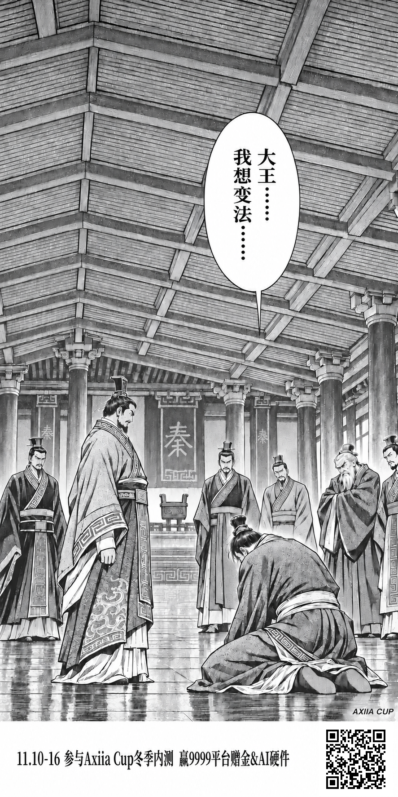
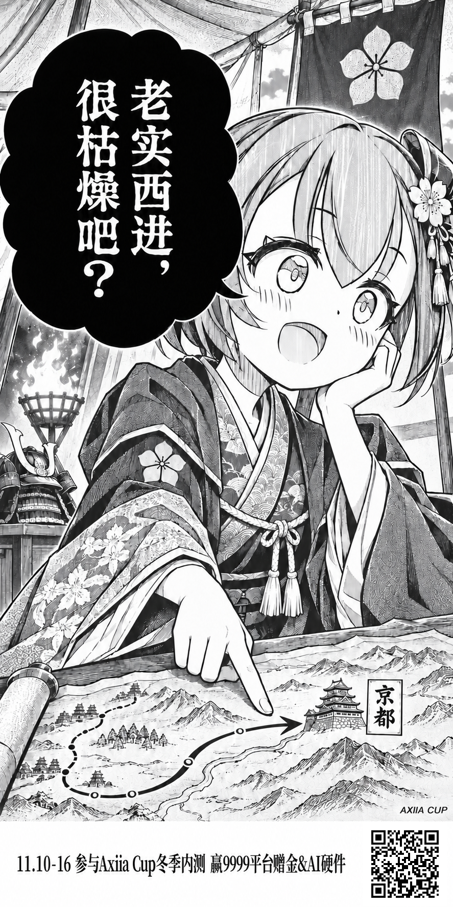
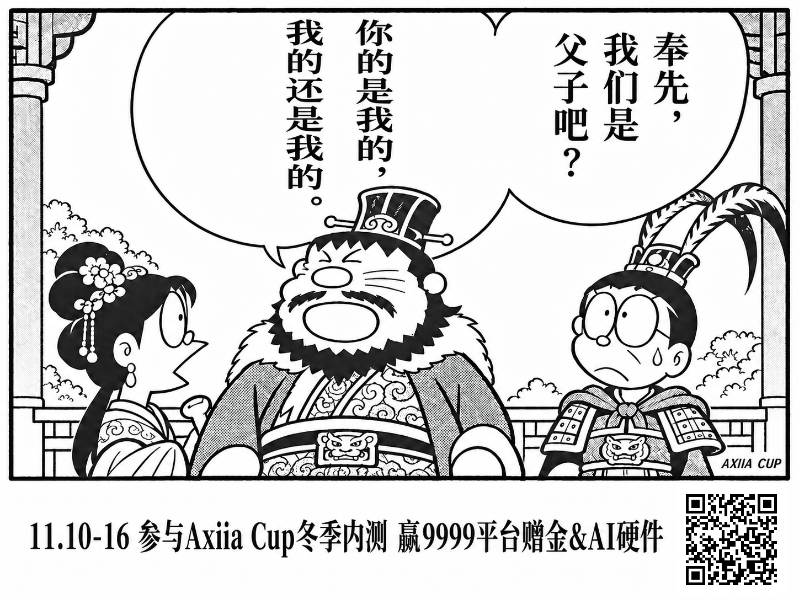

# Axiia Cup 冬季内测漫画海报

本目录保存 11.10–16 活动的三张成品，以及可继续编辑、重新贴码的底图和工作流。

统一宣传文案：

> 11.10-16 参与Axiia Cup冬季内测 赢9999平台赠金&AI硬件

所有成品中的二维码编码为：

[https://axiia-cup.isofucius.cn/?invite=axiia_cup](https://axiia-cup.isofucius.cn/?invite=axiia_cup)

## 成品预览与下载

| 商鞅：我想变法 | 老实西进，很枯燥吧？ | 奉先，你的是我的 |
| --- | --- | --- |
| [](assets/final/01-shangyang.png) | [](assets/final/02-westward.png) | [](assets/final/05-dongzhuo-lvbu.png) |
| 887 × 1774，竖版 1:2 | 887 × 1774，竖版 1:2 | 1448 × 1086，横版 4:3；貂蝉无台词 |

独立二维码：[PNG](assets/qr/invite-axiia-cup.png) · [SVG](assets/qr/invite-axiia-cup.svg)。

## 核心工作流文档

1. [工作流总纲](workflow/00-workflow.md)：入口、分工、操作顺序与交付文件。
2. [视觉与排版规格](workflow/01-visual-spec.md)：细高字体、白栏、宣传文案及贴码坐标。
3. [五张二创内容方案](workflow/02-concepts.md)：已选主题、人物、台词和当前出图状态。
4. [生图提示词模板](workflow/03-image-prompts.md)：参考图分工及当前活动的生成约束。
5. [贴码与验收规范](workflow/04-qr-validation.md)：重新生成二维码、贴码及验收命令。

附：[原梗与图源](SOURCES.md)、[按当前成品规格整理的生产提示词](prompts/README.md)、[邀请码预填前端交接说明](registration-invite-handoff.md)。

## 复现与验证

在 Python 虚拟环境中安装依赖，然后从本目录执行：

```sh
python -m pip install -r tools/requirements.txt
python tools/verify_assets.py
```

重新贴码示例，输出文件须使用新名字：

```sh
python tools/paste_qr.py assets/base/01-shangyang.png /tmp/shangyang.png
python tools/paste_qr.py assets/base/02-westward.png /tmp/westward.png
python tools/paste_qr.py assets/base/05-dongzhuo-lvbu.png /tmp/dongzhuo-lvbu.png --layout layouts/landscape.json
```

脚本使用仓库相对配置，可以在 Windows 和 WSL 中运行；将示例中的输出路径替换为自己的路径即可。

当前资产清单和哈希见 [manifest.json](manifest.json)，验证结果见 [validation.json](validation.json)。验证包括二维码原尺寸、474 像素宽缩图、JPEG 质量 85 压缩，以及贴码框外逐像素一致。

二维码负责携带 `invite=axiia_cup`。注册页自动填码依赖网站前端读取并传递这个参数；资产验证不等同于网站功能已经上线。
